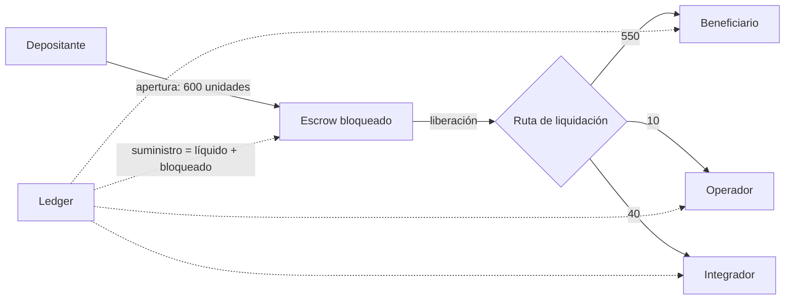
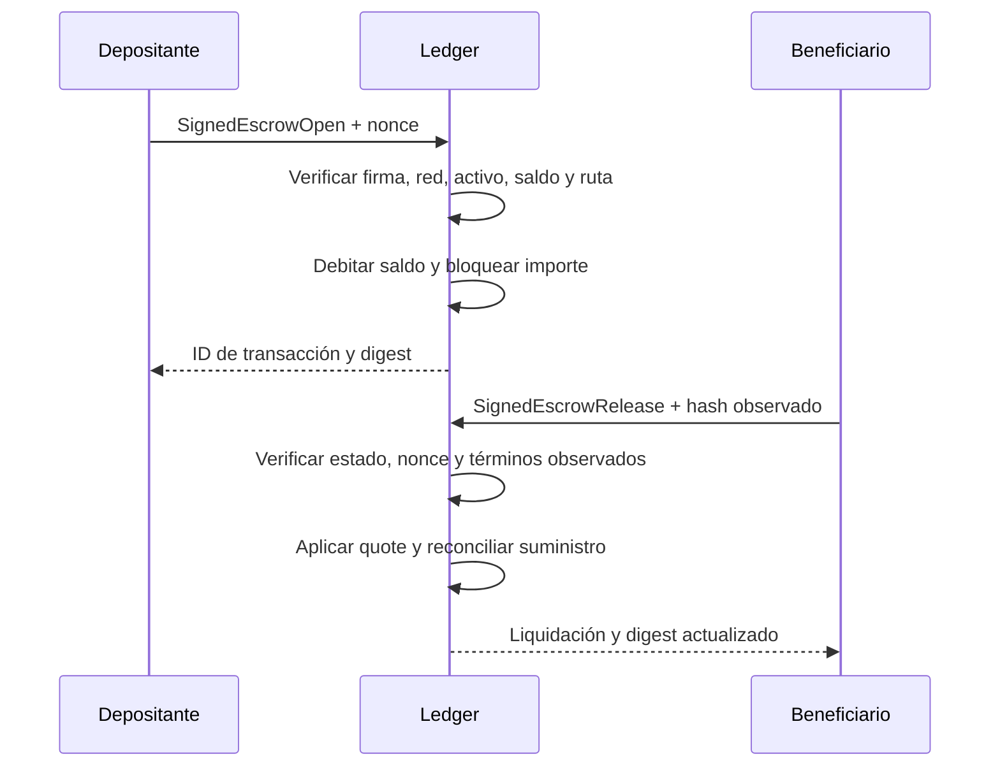

# Prism DTL


Prism DTL es un núcleo de liquidación en Rust para un libro de transacciones
distribuido con custodia de valor. Modela movimientos firmados mediante
registro de cuentas, aperturas de escrow, liberaciones autorizadas por el
beneficiario, enrutamiento por operador, rebates de integrador y compromisos de
estado deterministas.

El crate está diseñado como un núcleo de protocolo compacto: lo bastante pequeño
para revisarse de extremo a extremo, pero organizado con los límites que se
esperarían en un ledger de producción: identidades canónicas, firmas separadas
por dominio, protección contra repetición mediante nonces, liquidación con rutas,
aritmética comprobada y reconciliación de suministro.

## Resumen del protocolo

Prism registra un único activo nativo entre cuentas registradas y estados de
escrow. Un depositante abre un escrow con una instrucción firmada. El ledger
debita al depositante, registra el valor bloqueado y avanza el nonce del
depositante.

El beneficiario autoriza más tarde la liberación firmando una instrucción
vinculada al ID del escrow y al hash observado de los términos actuales. Durante
la liberación, el ledger distribuye el importe bloqueado entre el beneficiario,
el operador de ruta y el destinatario opcional del rebate de integrador; después
marca el escrow como liberado y avanza el nonce de liberación del beneficiario.

Cada operación que cambia estado se aplica primero sobre un ledger candidato y
solo se confirma cuando la transición termina y las comprobaciones de
conservación son correctas.

## Propiedades principales

- Los IDs de cuenta se derivan de claves públicas Ed25519.
- Los IDs de escrow, IDs de transacción y digests de estado son compromisos
  Blake3 separados por dominio.
- Las aperturas de escrow requieren la firma del depositante.
- Las liberaciones de escrow requieren la firma del beneficiario.
- Los nonces del depositante impiden repetir instrucciones de apertura.
- Los nonces de liberación impiden repetir instrucciones de liberación.
- Los importes usan unidades enteras acotadas con aritmética comprobada.
- El ledger reconcilia balances líquidos más valor de escrow no liberado contra
  el suministro total tras cada transición confirmada.
- La apertura valida la distribución económica antes de inmovilizar saldo.
- Las vistas `SettlementQuote` y `SupplySnapshot` exponen importes y estados
  para integración, conciliación y observabilidad.

## Flujo de valor



Para una ruta con 600 unidades brutas, comisión de operador de 10 y rebate de
40, `SettlementPath::quote` calcula 50 de cargos y 550 netas para el
beneficiario. La suma de las salidas siempre debe igualar las 600 unidades
inmovilizadas. El modelo utiliza enteros; las aplicaciones que muestran
decimales deben fijar la escala fuera del crate.

## Ciclo de autorización y estado



## Arquitectura

- `amount`: unidades acotadas del activo con aritmética comprobada.
- `ids`: IDs de cuenta, activo, escrow, digest y transacción separados por
  dominio.
- `crypto`: material de claves Ed25519, identidades y verificación de firmas.
- `escrow`: términos canónicos de escrow, instrucciones de liberación y
  envelopes firmados.
- `ledger`: estado de cuenta, estado de escrow, diario de liquidación y
  reconciliación.
- `error`: superficie de errores tipados del protocolo.

Las decisiones de secuenciación, persistencia y custodia de claves pertenecen
al servicio que integra el crate; no están implementadas por esta biblioteca.

## Documentación

- [Arquitectura y estados](docs/arquitectura.md): contratos entre módulos y
  transiciones del ledger.
- [Modelo económico](docs/modelo-economico.md): distribución, conservación y
  ejemplos numéricos.
- [Integración](docs/integracion.md): configuración, ciclo de firma y manejo
  de errores.
- [Operación y observabilidad](docs/operacion.md): métricas, reconciliación y
  procedimiento ante divergencias.
- [Seguridad operativa](docs/seguridad-operativa.md): fronteras de confianza,
  controles y respuesta a incidentes.

## Estructura del repositorio

```text
src/                 Núcleo del protocolo
examples/            Generador de vectores de escenario usado por los tests
tests/escrow_flow.rs Tests de integración en Rust
tests/node/          Tests JavaScript/Bun de contrato de wire y escenarios
tests/helpers/       Helpers compartidos para los tests JavaScript
scripts/             CI local y comprobaciones JavaScript
.github/             CI de GitHub Actions y configuración de Dependabot
```

## Desarrollo

Ejecutar la suite completa de verificación local:

```powershell
bun run test:all
```

Ejecutar el script corto desde Bash:

```bash
bash scripts/tests.sh
```

Este script ejecuta los tests Rust y los tests JavaScript mediante Bun. En
Windows, la validación completa recomendada es `bun run test:all`.

Ejecutar directamente las comprobaciones Rust:

```powershell
cargo fmt --all -- --check
cargo build --all-targets --locked
cargo test --locked
cargo clippy --all-targets --all-features --locked -- -D warnings
```

Ejecutar las comprobaciones de integración JavaScript/Bun:

```powershell
bun install --frozen-lockfile
bun run fmt:check
bun run build
bun test --timeout 30000 ./tests/node
```

Generar un vector de escenario de ejemplo:

```powershell
cargo run --quiet --example scenario_vectors -- direct-release
cargo run --quiet --example scenario_vectors -- routed-release
```

## CI

GitHub Actions ejecuta jobs separados para Rust y Bun:

- Formato, compilación, tests y clippy para Rust.
- Instalación de dependencias Bun, comprobación de formato, validación de
  sintaxis JavaScript y tests de integración con Bun.

Dependabot está configurado para crates Rust, paquetes Bun y GitHub Actions.
