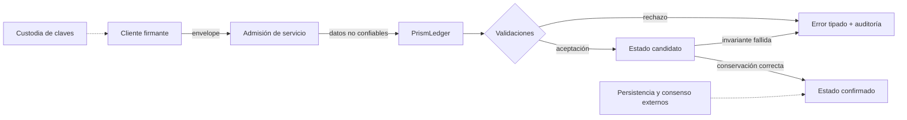

# Política de seguridad

Prism DTL es un núcleo de liquidación. Su modelo de seguridad se centra en
preservar movimientos de valor autorizados, resistencia a repetición,
derivación determinista de identidades y reconciliación de suministro dentro de
la máquina de estados del ledger.

## Modelo de seguridad

El ledger trata todos los envelopes recibidos como entrada no confiable. Las
APIs públicas verifican consistencia de identidad, firmas, nonces, existencia de
cuentas, identidad del activo e identidad de red antes de confirmar estado.

Las transiciones se aplican primero sobre un ledger candidato. El candidato se
confirma solo cuando la transición termina y las comprobaciones de conservación
son correctas.

## Límites de confianza

- Las claves de firma se controlan fuera del crate.
- Las identidades de cuenta registradas deben corresponder con sus claves
  públicas.
- Los llamadores pueden enviar envelopes antiguos, malformados, repetidos o de
  otra red.
- El almacenamiento, la red, el ordenamiento de mempool y el consenso deben ser
  proporcionados por servicios de nivel superior.
- Este crate asume un único activo nativo para la instancia del ledger.



## Controles aplicados

- Firmas Ed25519 sobre payloads separados por dominio.
- IDs de cuenta derivados de claves públicas.
- IDs de escrow canónicos derivados de depositante, beneficiario, nonce y hash
  de memo.
- Instrucciones de apertura autorizadas por el depositante.
- Instrucciones de liberación autorizadas por el beneficiario.
- Comprobaciones de nonce del depositante para aperturas de escrow.
- Comprobaciones de nonce del beneficiario para liberaciones de escrow.
- Seguimiento de transacciones duplicadas.
- Aritmética comprobada para todas las sumas y restas de importes.
- Comprobaciones de activo y red en instrucciones de liquidación.
- Comprobaciones de existencia de cuentas para beneficiarios, operadores y
  destinatarios de rebate.
- Comprobaciones de conservación tras aperturas y liberaciones confirmadas.
- Presupuesto de ruta validado durante la apertura mediante
  `SettlementPath::quote` y nuevamente al liquidar.
- Snapshot de suministro consultable sin mutar estado para conciliación
  externa.

## Invariantes del protocolo

- Una identidad de cuenta registrada debe ser internamente consistente.
- Un depositante no puede abrir un escrow sin balance líquido suficiente.
- Un escrow no puede abrirse dos veces.
- Un escrow no puede liberarse dos veces.
- Una liberación debe referenciar el hash actual de los términos del escrow.
- Las comisiones de operador más rebates no deben superar el importe del escrow.
- Los balances líquidos más el valor de escrow no liberado deben igualar el
  suministro total.
- `beneficiary_amount + operator_fee + rebate_amount = gross_amount` para
  cada quote aceptada.
- Los digests de estado deben cambiar cuando cambia el estado confirmado del
  ledger.

## Requisitos de integración

Los despliegues construidos sobre Prism DTL deberían añadir:

- Almacenamiento duradero con escrituras atómicas y semántica de recuperación.
- Consenso o secuenciación para ejecución ordenada de transacciones.
- Gestión externa de claves o firma respaldada por hardware.
- Rate limiting y control de admisión para envío público de transacciones.
- Registro de auditoría alrededor del alta de cuentas y llamadas de
  liquidación.
- Métricas en runtime para suministro total, valor bloqueado, fallos de
  liberación e intentos repetidos.
- Procedimientos de backup y restauración para snapshots del ledger.

No se debe usar la conservación de suministro como sustituto de una revisión
de destinatarios o de la política comercial de una ruta. Es una propiedad
contable, no una aprobación de contraparte.

## Higiene de dependencias

El repositorio usa grafos de dependencias Rust y Bun bloqueados para CI. Las
actualizaciones de dependencias se gestionan mediante Dependabot y deben pasar
la suite completa de verificación antes de integrarse:

```powershell
bun run test:all
```

## Reporte

Los asuntos sensibles de seguridad deben reportarse de forma privada a los
mantenedores. Incluye:

- Commit o release afectado.
- Pasos mínimos de reproducción.
- Comportamiento esperado frente a comportamiento observado.
- Envelope de transacción, digest de estado o vector de test relevante.

Evita la divulgación pública hasta que los mantenedores hayan podido evaluar el
caso y preparar una corrección.
