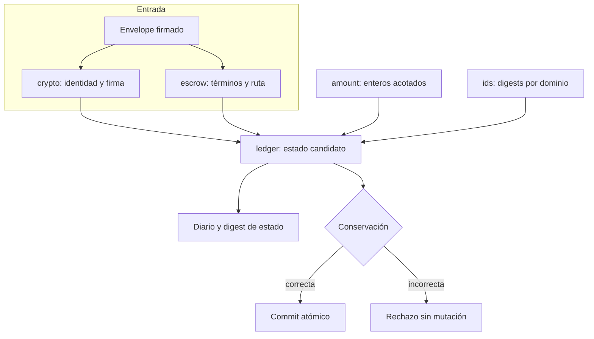

# Arquitectura y máquina de estados

Prism DTL separa identidad, autorización, cálculo económico y aplicación del
ledger. Una instancia de `PrismLedger` representa una red (`network_id`) y un
activo (`AssetId`). No incluye transporte, consenso ni almacenamiento
duradero: el integrador debe aportar esas capas sin convertir una respuesta
local en una confirmación global prematura.

## Ciclo del escrow

| Estado | Activo líquido | Valor bloqueado | Operación que avanza |
| --- | ---: | ---: | --- |
| Sin abrir | En depositante | 0 | Apertura firmada válida |
| Abierto | Debitado al depositante | Importe íntegro | Liberación firmada válida |
| Liberado | Distribuido entre destinatarios | 0 | Estado final |

`EscrowId` se deriva de depositante, beneficiario, nonce y hash de memo. El
ledger rechaza una segunda apertura del mismo identificador. El nonce de
apertura pertenece al depositante; el de liberación, al beneficiario. Un
`TxId` identifica el envelope procesado y el digest de estado permite a una
capa superior comparar réplicas.

## Fronteras de atomicidad

`open_escrow` y `release_escrow` clonan el estado en un candidato, aplican la
transición y comprueban `verify_conservation` antes de reemplazar el estado
vivo. Un error de firma, balance, nonce, red, activo, ruta o conservación deja
el ledger anterior intacto. Esta propiedad se refiere al estado en memoria;
para una base de datos real hace falta transacción duradera y recuperación tras
fallo de proceso.

## Vistas de lectura

- `SettlementPath::quote(amount)` calcula la distribución bruta y neta sin
  alterar saldos. Rechaza cargos superiores al importe bruto.
- `supply_snapshot()` devuelve saldo líquido, saldo bloqueado, suministro
  declarado y número de escrows abiertos/liberados.
- `state_digest()` compromete cuentas, escrows, transacciones vistas y
  suministro. El diario no se incluye en ese digest; debe protegerse y
  archivarse por separado en la capa de persistencia.

Las vistas son herramientas de conciliación, no sustitutos de la verificación
de un envelope durante la transición definitiva.
