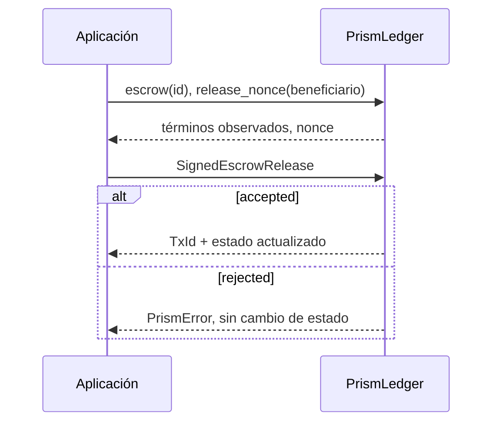

# Integración del crate

Prism es una biblioteca Rust. El integrador controla el ciclo de vida del
ledger, la identidad de red, la custodia de claves, la secuencia de mensajes y
la persistencia. La API no abre sockets ni envía transacciones a una red.

## Inicialización

1. Definir `network_id` y `AssetId::native()` para la instancia.
2. Registrar cada `PublicIdentity`; la cuenta debe derivarse de su clave.
3. Aplicar créditos génesis solo mediante un proceso de arranque autorizado.
4. Persistir un snapshot y el diario con una frontera de commit común.
5. Si se utiliza un programa respaldado, depositar el bono del operador y
   establecer una `BondedRebatePolicy` para el epoch operativo. Estas dos
   llamadas pertenecen al plano de control privilegiado del integrador.

## Apertura

El cliente construye `EscrowTerms::new` con importe positivo, nonce vigente,
beneficiario, memo y ruta. Antes de presentar el envelope, puede obtener
`terms.settlement_path.quote(terms.amount)` para mostrar la distribución.
`SignedEscrowOpen::sign` requiere la clave del depositante. El servicio invoca
`open_escrow`; un resultado exitoso devuelve `TxId` y cambia el estado
atómicamente en memoria.
La firma cubre todos los campos de `settlement_path`; cualquier cambio en
destinatarios, importes o epoch exige una nueva firma del depositante.

```rust
let quote = terms.settlement_path.quote(terms.amount)?;
assert_eq!(
    quote.beneficiary_amount.units() + quote.total_charges.units(),
    quote.gross_amount.units()
);
let envelope = SignedEscrowOpen::sign(terms, &depositor_key)?;
let tx_id = ledger.open_escrow(&envelope)?;
```

## Liberación

El beneficiario consulta el escrow admitido y su `terms_hash`, obtiene su
`release_nonce` y firma `EscrowRelease`. `release_escrow` comprueba identidad,
red, estado, nonce y hash observado antes de aplicar los abonos. Una respuesta
`TermsHashMismatch` requiere refrescar la vista y revisar los términos
observados; no se debe reintentar ciegamente con un hash nuevo.
La firma del beneficiario cubre también `observed_terms_hash`. Antes de
mostrar el importe final, el integrador puede consultar
`bonded_rebate_quote(escrow_id)`; `None` indica que no hay programa para la
ruta y epoch actuales. El resultado es una vista, no una reserva de fondos.



## Errores y reintentos

`NonceMismatch`, `DuplicateTransaction` y `EscrowReleased` indican que el
cliente debe volver a leer el estado. `InvalidSignature`,
`UnauthorizedDepositor` y `UnauthorizedRelease` requieren intervención de
identidad. `Conservation` debe parar la aplicación de nuevos mensajes y abrir
una investigación de estado. El servicio debe asociar cada respuesta al
digest anterior y posterior, no solo al `TxId`.
