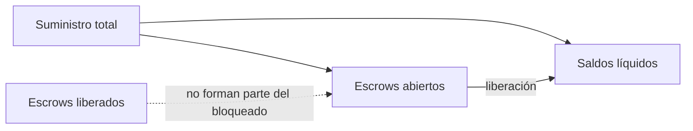

# Modelo económico y conciliación

La unidad base es un entero `u128` acotado por `MAX_PRISM_SUPPLY` (10¹³
unidades). Prism no interpreta decimales ni precios de mercado: un adaptador
puede presentar seis o dieciocho decimales, pero debe hacerlo de forma
uniforme en depósitos, rutas, comisiones y reportes.

## Distribución de una liberación

Para importe bruto `G`, comisión de operador `O` y rebate `R`:

```text
C = O + R                       (suma comprobada)
B = G - C                       (resta comprobada, requiere C <= G)
B + O + R = G                   (conservación por liquidación)
```

`SettlementQuote` devuelve los cinco valores `gross_amount`,
`beneficiary_amount`, `operator_fee`, `rebate_amount` y `total_charges`.
`rebate_recipient` ausente envía el importe de rebate al beneficiario; por
tanto, la recepción efectiva del beneficiario sería `B + R` en ese caso.
La cuota se calcula en apertura y se recalcula en liberación.

| Concepto | Ruta directa | Ruta con operador e integrador |
| --- | ---: | ---: |
| Escrow bloqueado | 600 | 600 |
| Comisión operador | 0 | 10 |
| Rebate | 0 | 40 |
| Beneficiario neto | 600 | 550 |
| Total acreditado | 600 | 600 |

## Balance global



La invariante global es `total_supply = Σ account.balance + Σ
escrow.amount` para escrows no liberados. Un escrow liberado permanece como
registro histórico, pero su importe ya está en los saldos de destinatarios.
`verify_conservation` detecta inflación, pérdida contable o doble cómputo; no
determina si una ruta satisface acuerdos comerciales fuera del ledger.

## Cotas y rechazo

- `Amount::new` rechaza valores superiores a 10¹³.
- `checked_add` y `checked_sub` rechazan overflow y underflow.
- Una ruta con `O + R > G` se rechaza antes de debitar al depositante.
- La financiación génesis aumenta saldo y suministro conjuntamente. No es una
  API de emisión pública: el servicio que la use debe limitarla a su fase de
  inicialización y registrar su procedencia.

Para métricas financieras externas, registrar por transacción el importe
bruto, los tres abonos, el valor bloqueado antes/después y el digest de estado.
No calcular PnL a partir de una vista parcial de cuentas.
