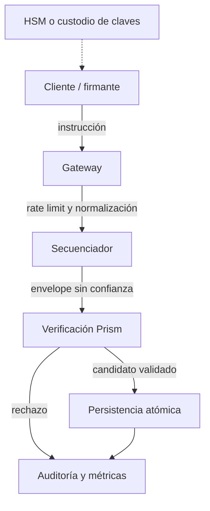

# Seguridad operativa

El motor valida envelopes no confiables, pero delega controles de acceso de
red, custodia de claves, secuenciación, límites de admisión y persistencia en
el sistema anfitrión. Los límites de confianza deben documentarse antes de
exponer una API pública.

## Controles por frontera

- **Cliente:** proteger claves Ed25519, mostrar red, importe, destinatarios y
  coste estimado antes de firmar; evitar reintentos sin volver a leer nonces.
- **Gateway:** imponer tamaños máximos de envelope, autenticación de API,
  límites por identidad y trazas con identificadores no sensibles.
- **Secuenciador:** serializar las mutaciones de una misma instancia de ledger
  y conservar el orden aplicado para recuperación determinista.
- **Ledger:** verificar identidad, firmas, nonces, activo, red, cuentas
  registradas, presupuesto de ruta, bono y conservación.
- **Plano de control:** autorizar por separado financiación de bonos y cambios
  de política por operador y epoch; conservar aprobación y digest anterior.
- **Persistencia:** commit atómico de estado y diario, backups probados y
  comparación periódica de digests.

## Respuesta a incidentes

Una anomalía económica no siempre viola `total_supply`: un valor puede estar
contablemente conservado y, aun así, aparecer en un destinatario inesperado.
Por eso las alertas de conciliación deben incluir distribución por cuenta y
por ruta, además de la suma global. Ante discrepancia, inmovilizar la admisión,
preservar envelopes y firmas originales, reconstruir los estados previo y
posterior y escalar la decisión de reapertura a una persona responsable.
Los rebates respaldados requieren además cotejar saldo del bono antes/después
y abonos efectivos al destinatario. Un `SupplySnapshot` equilibrado no
demuestra por sí solo que el incentivo siga la política comercial aprobada.

Consultar también [SECURITY.md](../SECURITY.md) para el alcance del reporte
privado de seguridad y la política de dependencias.
